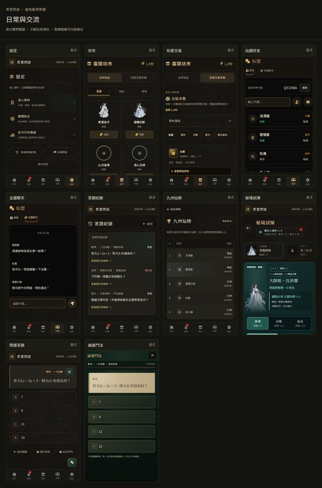
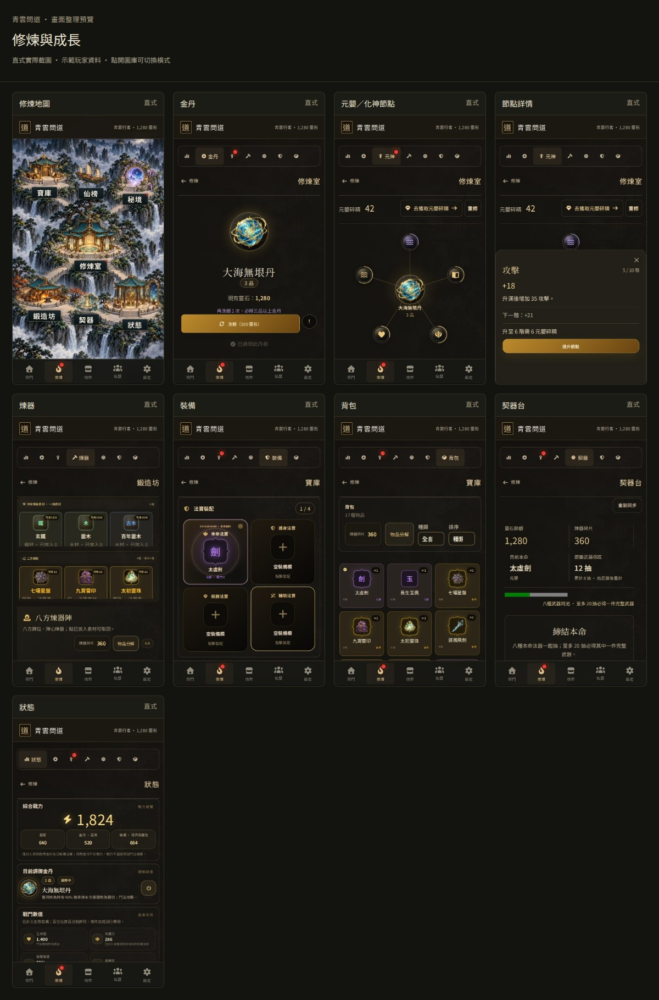

# 畫面整理預覽

分支：`design/interface-cleanup-20261023`。這一輪將首頁的整理方式延伸到其他主要玩家頁面。

- 統一標題、分頁、欄位與按鈕的層級，減少重複外框與裝飾光暈。
- 坊市先看商品；玩家市集的「發布委託」點開後才顯示表單。
- 設定以個人資料、範圍設定、能力分析分區，紀錄與問題回報放在下方。
- 修煉保留場景、法寶品級與球形節點；量測分頁及標題列下方的實際空間，讓節點圖完整顯示。
- 節點詳情橫式佔右側 30%，直式由下往上佔 50% 並蓋過導覽；縮整內容，讓升級操作容易看見。
- 好友與聊天保留各自的捲動區，答題頁統一選項間距並避開助手與底部操作重疊。

## 截圖圖庫

[開啟完整圖庫](index.html)，可切換橫式／直式，點圖查看原尺寸。





| 頁面／狀態 | 橫式 | 直式 |
| --- | --- | --- |
| 宗門首頁 | [截圖](home-landscape.jpg) | [截圖](home-portrait.jpg) |
| 首頁展開紀錄 | [截圖](home-landscape-records.jpg) | [截圖](home-portrait-records.jpg) |
| 設定 | [截圖](settings-landscape.jpg) | [截圖](settings-portrait.jpg) |
| 坊市 | [截圖](store-landscape.jpg) | [截圖](store-portrait.jpg) |
| 玩家交易 | [截圖](market-landscape.jpg) | [截圖](market-portrait.jpg) |
| 仙盟好友 | [截圖](social-landscape.jpg) | [截圖](social-portrait.jpg) |
| 全服聊天 | [截圖](chat-landscape.jpg) | [截圖](chat-portrait.jpg) |
| 答題紀錄 | [截圖](history-landscape.jpg) | [截圖](history-portrait.jpg) |
| 九州仙榜 | [截圖](rank-landscape.jpg) | [截圖](rank-portrait.jpg) |
| 修煉地圖 | [截圖](training-map-landscape.jpg) | [截圖](training-map-portrait.jpg) |
| 金丹 | [截圖](core-landscape.jpg) | [截圖](core-portrait.jpg) |
| 元嬰／化神節點 | [截圖](nascent-landscape.jpg) | [截圖](nascent-portrait.jpg) |
| 節點詳情 | [截圖](nascent-detail-landscape.jpg) | [截圖](nascent-detail-portrait.jpg) |
| 煉器 | [截圖](refinery-landscape.jpg) | [截圖](refinery-portrait.jpg) |
| 裝備 | [截圖](equipment-landscape.jpg) | [截圖](equipment-portrait.jpg) |
| 背包 | [截圖](bag-landscape.jpg) | [截圖](bag-portrait.jpg) |
| 契器台 | [截圖](contract-landscape.jpg) | [截圖](contract-portrait.jpg) |
| 狀態 | [截圖](status-landscape.jpg) | [截圖](status-portrait.jpg) |
| 秘境試煉 | [截圖](raid-landscape.jpg) | [截圖](raid-portrait.jpg) |
| 問道答題 | [截圖](quiz-landscape.jpg) | [截圖](quiz-portrait.jpg) |
| 論道鬥法 | [截圖](battle-landscape.jpg) | [截圖](battle-portrait.jpg) |

## 驗證範圍

截圖為本機 Chromium 載入此分支的正式 `stage.html`／`index.html`、樣式與頁面渲染程式後擷取；首頁使用 116 修為示例，其餘頁面使用 248 修為示例。資料為本機樣本，停用正式帳號、資料庫與遊戲 API。好友、聊天、排行和紀錄填入示例列；修煉、背包、契器、市集、秘境與鬥法使用原有渲染函式。截圖不代表正式帳號端到端測試。

- 橫式瀏覽器 1440 × 810，遊戲邏輯畫布 1280 × 720。
- 直式瀏覽器 390 × 844，實際遊戲畫布截圖為 390 × 693、邏輯畫布 360 × 640。
- 預覽腳本完成首頁與其他 19 種頁面／狀態的橫直式檢查：無文件水平溢位、外層捲動位置維持 0，無 JavaScript 頁面錯誤。
- 驗證首頁主操作、圖錄與紀錄展開、設定展開、實際坊市篩選、市集表單展開及重新渲染後保留展開狀態。
- 驗證節點詳情的 30%／50% 尺寸、直式覆蓋導覽、升級按鈕可見及關閉；煉器下方配方操作可捲動至導覽上方。
- `npm test`：1,789 項通過；靜態資源版本檢查通過。尚未進行 Safari 實機驗證。

## 實作位置

其他頁面的整理集中於 `public/styles/interface-cleanup-pages.css`，由 `public/index.html` 引入。`main-legacy.js` 增加社交頁樣式掛點；`player-marketplace.js` 使用原生 details 整理委託表單；`content-capacity-layout.js` 改為量測實際內容頂端，預留修煉標題列的高度。遊戲數值與交易流程沿用既有邏輯。

## 重現

`scripts/capture-interface-cleanup.cjs` 與 `scripts/interface-preview-pages.cjs` 是隔離的本機擷取工具；需要 Playwright、Chromium、Tailwind CSS 與字型套件。

```sh
npm install --prefix /tmp/ui-preview playwright tailwindcss@3 @fontsource/noto-serif-tc @fontsource/noto-sans-tc @fortawesome/fontawesome-free --no-save
printf '@tailwind base;\n@tailwind components;\n@tailwind utilities;\n' > /tmp/ui-tailwind-input.css
/tmp/ui-preview/node_modules/.bin/tailwindcss -i /tmp/ui-tailwind-input.css -o /tmp/ui-tailwind.css --content './public/**/*.html,./public/**/*.js' --minify
NODE_PATH=/tmp/ui-preview/node_modules UI_CAPTURE_PAGES=all node scripts/capture-interface-cleanup.cjs
NODE_PATH=/tmp/ui-preview/node_modules node scripts/build-interface-review.cjs
```

需先安裝 Playwright Chromium，或以 `UI_CAPTURE_BROWSER` 指向現有 Chromium。可用 `UI_CAPTURE_DEPS`、`UI_CAPTURE_TAILWIND`、`UI_CAPTURE_OUTPUT` 改變依賴及輸出路徑；`UI_CAPTURE_FILTER=store,settings` 可只擷取指定頁面。`BASELINE=1` 擷取整理前首頁，基準由 `UI_CAPTURE_BASE_REF` 指定。
