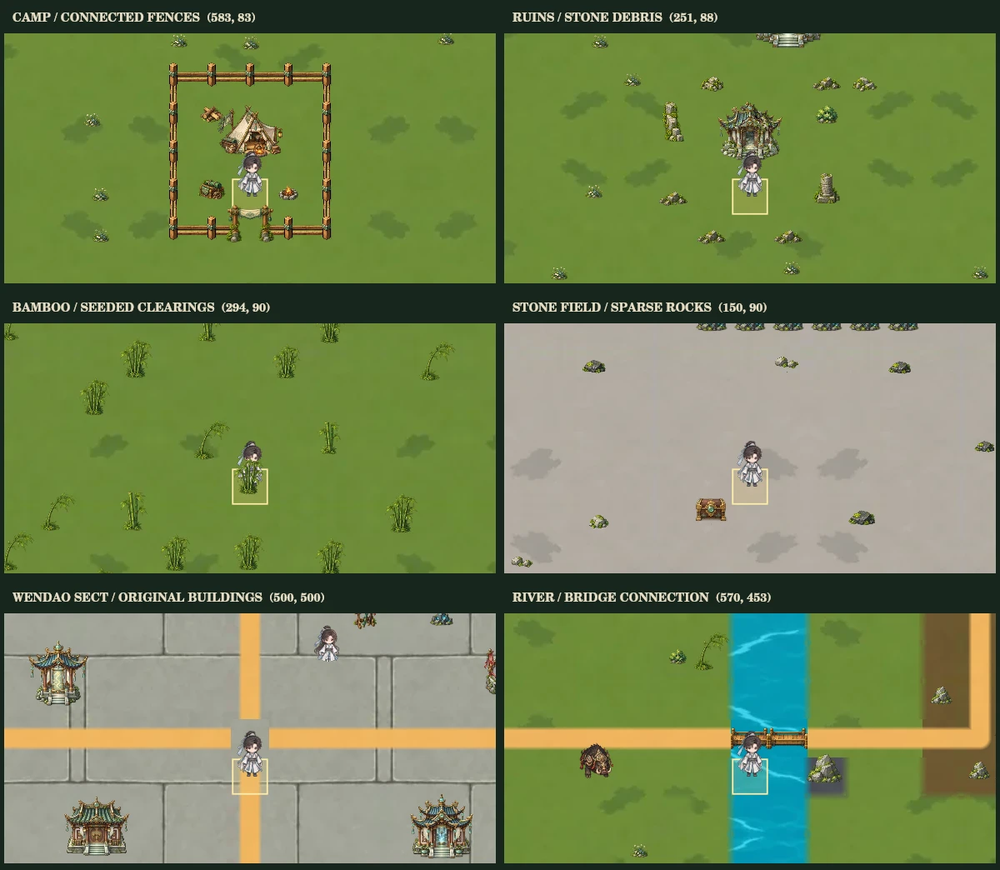

# 地景驗證

`native/overview.webp` 與 `native/phone.webp` 使用正式的 `WorldRenderer`，透過原生 Canvas 繪製相同種子的實際生成區域，包括營地、遺跡、竹林、石域、問道宗及橋梁。這組預覽關閉遊戲內名稱文字，因原生環境未安裝中文字型；遊戲中的標籤程式保留原樣。

`native/validation.json` 記錄載入圖片數、地景數量、快取上限與像素驗證。相同時間重繪的像素一致；鏡像材質的邊界最大像素差為 0。

可安裝選用的 `@napi-rs/canvas` 後執行 `node scripts/capture-world-scenery-native.cjs` 重現。具備 Playwright Chromium 的環境也可執行既有的 `scripts/capture-world-scenery.cjs` 取得瀏覽器預覽。
