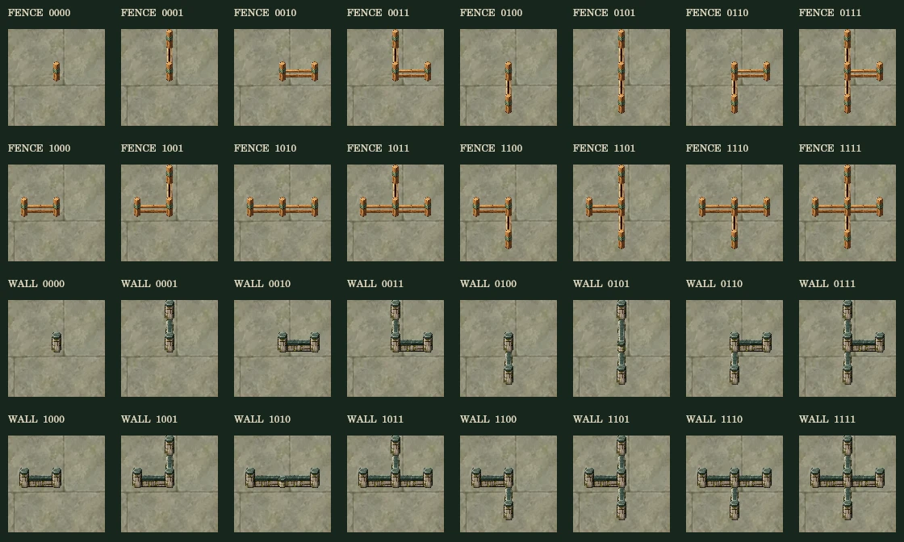
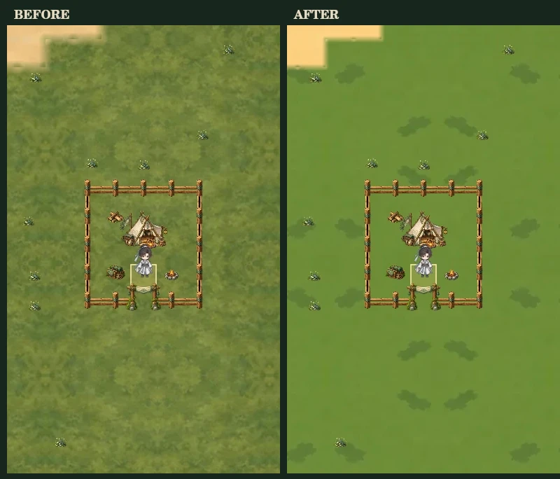

# 地景驗證

`native/overview.webp` 與 `native/phone.webp` 使用正式的 `WorldRenderer`，透過原生 Canvas 繪製相同種子的實際生成區域，包括營地、遺跡、竹林、石域、問道宗及橋梁。這組預覽關閉遊戲內名稱文字，因原生環境未安裝中文字型；遊戲中的標籤程式保留原樣。

`native/validation.json` 記錄載入圖片數、地景數量、快取上限與像素驗證。相同時間重繪的像素一致；鏡像材質的邊界最大像素差為 0。

`native/connections.webp` 顯示柵欄、圍牆各 16 種四向連接狀態。畫面中的每個地格只繪製一個中心與必要的半段；在獨立透明畫布上檢查兩種材質的橫向、縱向共享邊界，確定沒有透明裂縫。測試也涵蓋移除鄰格、跨區塊／畫面邊界、迷霧及入口朝向。

可安裝選用的 `@napi-rs/canvas` 後執行 `node scripts/capture-world-scenery-native.cjs` 重現。具備 Playwright Chromium 的環境也可執行既有的 `scripts/capture-world-scenery.cjs` 取得瀏覽器預覽。

地面清晰度更新的同場景對照見 `native/ground-comparison.webp`（左為更新前、右為更新後）。高解析度手機畫面見 `native/phone-hidpi.webp`；原生 Canvas 驗證也檢查 DPR 2 下縮放 0.65、1、1.8 的實體像素快取尺寸，以及四種解析度的材質接縫。

