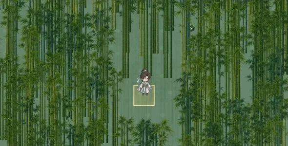

# 加密長直竹林素材

正式素材：`public/assets/world-map/ai/bamboo-upright-atlas.webp`。使用內建圖像生成工具產生透明竹子圖集，再等比例縮小、封裝為 768 × 1536 WebP（213,298 bytes）。四個獨立變體各 384 × 768，維持原始 1:2 比例，取代舊的 128 × 256 竹林圖集。

每格竹林的主竹叢出現率為 80%，第二叢為 35%，第三叢為 5%；平均 1.20 叢，比上一版的 1.60 叢再減少 25%，增加空隙並以單叢為主，少數區域保留兩至三叢。顯示高度 144–184px，約 3.6–4.6 格。位置、尺寸、變體都由既有世界種子決定，不改變地形、通行或儲存資料。

繪製範圍向兩側延伸 2 格、向下延伸 5 格，保留畫面外根部對應的可見竹冠，並延伸建築保留範圍。遮住本機玩家的前景竹叢透明度降至 8%，其餘竹林正常顯示。

以下以正式 WorldRenderer、預設種子 `qingyun-2026`、實際座標 (294, 90) 產生，角色位置 (294, 91)。原生 Canvas 預覽省略名稱標籤；遊戲標籤保留。



驗證包含瀏覽器／伺服器種子一致性、四個素材裁切範圍、DPR 2 最大縮放的原生解析度、視窗側邊與下緣竹冠、迷霧、角色可見性、通行與世界狀態不變。原生 Canvas 檢查重繪像素一致、地面接縫差為 0。

## 圖像生成提示詞

```text
Use case: stylized-concept. Asset type: transparent 2D sprite atlas for a Chinese xianxia top-down RPG. Generate ONE PORTRAIT PNG, requested canvas 1024 x 2048, a precise 2-column by 2-row grid, FOUR separate fully visible tall bamboo cutout sprites, one centered in each equal rectangular cell. Transparent empty background, not a scene, no ground, no tile square, no border, no text, no shadows. Each cell holds a small clump of 2 or 3 EXTREMELY LONG, SLENDER, perfectly STRAIGHT VERTICAL green bamboo culms. All trunks are parallel and upright, absolutely NO bending, arching, diagonal stems or leaning. Bamboo nodes visible with 12-16 long internodes. Bottom 70 percent is exposed long straight trunk; sparse elegant narrow pointed leaf sprays concentrated in upper 30 percent, small side shoots only. Full height from roots to top contained inside each cell with transparent gutters between the four sprites. Each silhouette must be at least 2.6 times taller than its foliage width. Four slightly different natural arrangements and green values, same scale. Clear sharp clean edges, restrained deep jade and fresh bamboo green, detailed hand-painted Chinese fantasy mobile game environment art with subtle dimensional shading, crisp readable at small size, no glow no haze no blur no bloom. Individual culms remain distinguishable. Composition is exactly four long slender bamboo clumps in a 2x2 atlas, with long straight exposed trunks extending toward the bottoms of their cells. The atlas will be cropped into four 512x1024 sprites so no element may cross any cell boundary. Render high quality.
```
